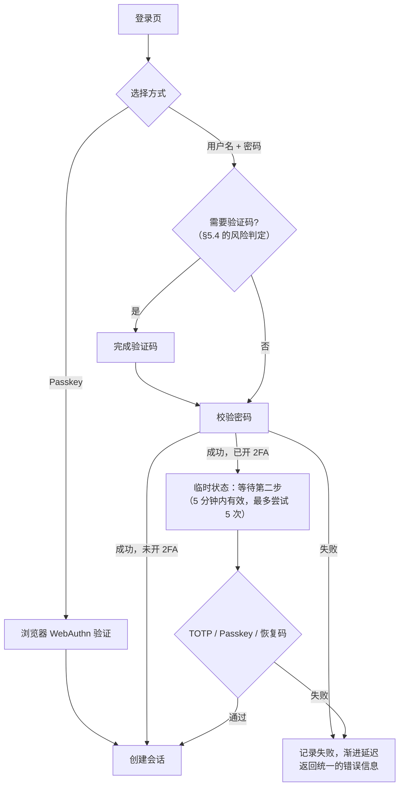
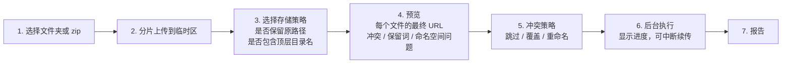
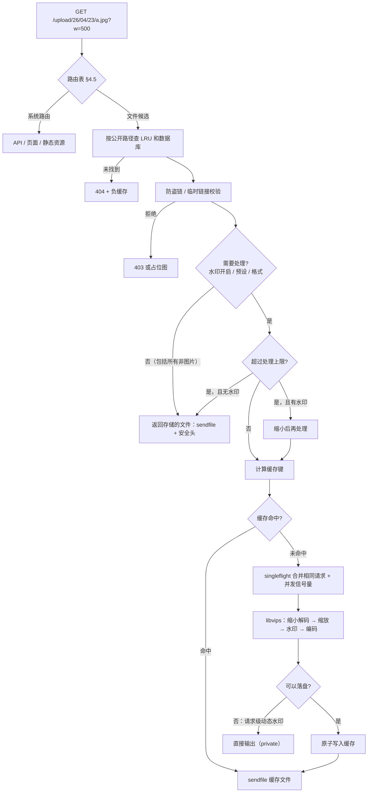
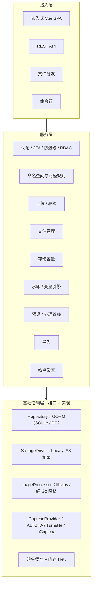
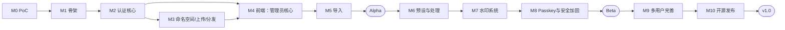

# UtopiaImages 需求分析与开发计划

> 版本：**v0.3** · 日期：2026-10-24 · 许可证：**MIT**
> 定位：给**站长自部署**、托管自己图片和静态资源的开源系统（不是面向公众的公共图床）
> 技术基线：Go + Vue 3 + libvips + Docker；SQLite 为默认数据库，持久层兼容 PostgreSQL
> 设计原则：**管理员体验优先**；多用户能力完整，但保持克制

---

## 0. v0.3 变更摘要

| # | 你的决定 | 本版的处理 |
|---|---|---|
| 1 | MIT 许可证 | 写入 §11 |
| 2 | 水印采用三级开关 | 保持不变 |
| 3 | 不需要请求配额，只限制存储空间；不开水印、不带处理参数时直接返回存储的文件 | 配额体系简化为**仅存储容量**；删除上传频率、访问限速、文件数上限（§3.7）；明确「返回的就是存储的文件」（§3.2） |
| 4 | 不支持游客上传 | 删除 |
| 5 | 不考虑兰空；SQLite + 持久层兼容，备选只有 PG | 删除所有兰空相关设计和 MySQL；测试矩阵只有 SQLite 和 PG |
| 6 | 普通用户的 URL 必须是 `/{username}/...`，只有管理员能使用根路径 `/...` | 新的 **URL 命名空间模型**（§4）；存储策略由用户自己设置（§8） |
| + | 现代认证方式 + 2FA（TOTP、Passkey）+ 防爆破（验证码等） | 重写认证章节（§5） |

---

## 1. 目标与非目标

### 1.1 目标
1. 一条 `docker run` 启动，在浏览器中完成初始化。
2. 按目录导入，**URL 原样保留**，与之前用的是哪个图床无关。
3. 分发性能接近 Nginx；图片处理首次在毫秒到几十毫秒级，之后命中缓存。
4. 站长一个人用得顺手；有需要时可以给少数人开账号。
5. 存储驱动、数据库、图像引擎都可替换，为云存储预留接口。

### 1.2 非目标（v1.0 不做）
公共图床的运营能力（开放注册、游客上传、请求配额、内容审核）、云存储驱动（只预留接口）、视频处理、MySQL。

---

## 2. 用户角色与公网访客

### 2.1 用户体系（后台账号）
| 用户组（内置） | 用途 | URL 空间 | 默认权限 |
|---|---|---|---|
| **管理员** | 站长 | 可以使用根路径 `/...`，也可以使用自己的 `/{username}/...` | 全部 |
| **上传者** | 站长开设的成员账号 | 只能使用 `/{username}/...` | 上传、管理自己的文件、水印、API 令牌 |

- 账号统一由管理员在后台开设或通过邀请开设，无开放注册；
- 管理员可新建自定义用户组（设置默认存储容量与权限）。

### 2.2 公网访客（Visitor）
- **访客不是用户账号，不能登录控制台**；
- 访客指公网直接通过 HTTP GET 请求图片/静态资源的外部浏览器或调用方；
- 访客行为仅受防盗链规则（Referer 白名单/空 Referer 策略）、同源隔离（CSP sandbox）、签名临时链接与 IP 限速控制。

---

## 3. 功能需求

优先级：**P0** = v1.0 必须；**P1** = v1.0 应该有；**P2** = 后续版本。

### 3.1 上传
| 编号 | 需求 | 优先级 |
|---|---|---|
| UP-01 | Web 上传：全局拖拽、Ctrl+V 粘贴、批量、进度条、失败重试 | P0 |
| UP-02 | 上传完成后显示链接：直链、Markdown、HTML、BBCode、缩略图 Markdown，一键复制，可设置默认复制格式 | P0 |
| UP-03 | 上传时选择自己的**存储策略**（决定 URL 路径和命名规则，§8） | P0 |
| UP-04 | 命名规则模板：`{Y}/{m}/{d}/{random:16}.{ext}`，变量包括 `{uuid}` `{md5}` `{sha1}` `{filename}` `{timestamp}` 等 | P0 |
| UP-05 | 用魔数识别真实类型；用户组可配置允许的类型 | P0 |
| UP-06 | 上传时可选转换格式（WebP / AVIF / JPEG / PNG）和质量 | P0 |
| UP-07 | 转换时保留转换前的原始文件：所有者可以在后台下载；它也占用磁盘，所以计入存储容量 | P0 |
| UP-08 | 可选去除 EXIF / GPS（先按方向信息自动旋转） | P1 |
| UP-09 | 分片上传（大文件、导入时必需，能绕过反向代理 / CDN 的请求体大小限制） | P0 |
| UP-10 | 记录 SHA-256，可选去重 | P2 |

### 3.2 分发（热路径）
| 编号 | 需求 | 优先级 |
|---|---|---|
| SV-01 | 请求路径与存储路径分离：按公开路径精确查找文件记录，再通过存储驱动读取 | P0 |
| SV-02 | **没开水印、也没有处理参数时，返回的就是存储的文件本身**（和 CSS / JS 一样，`sendfile` 零拷贝，不经过任何图像处理） | P0 |
| SV-03 | 支持 Range、ETag、Last-Modified、304 | P0 |
| SV-04 | 非图片文件 MIME 准确；CORS 头可按存储策略配置 | P0 |
| SV-05 | `Cache-Control` 可配置；动态水印的响应自动改为 `private` | P0 |
| SV-06 | 所有用户文件响应都带 `CSP: sandbox` 和 `nosniff`（同源安全，§4.4） | P0 |
| SV-07 | 不存在的路径使用短期负缓存 | P0 |

### 3.3 图片处理与预设样式
| 编号 | 需求 | 优先级 |
|---|---|---|
| IMG-01 | 管理员定义预设样式：名称、宽、高、裁剪方式、格式、质量 | P0 |
| IMG-02 | `?s=thumb` 指定样式；`?w=500&h=300` **就近匹配**到预设（§7） | P0 |
| IMG-03 | `?fmt=webp/avif/jpeg/png/auto`，`auto` 按 `Accept` 协商并返回 `Vary: Accept` | P0 |
| IMG-04 | 不放大超过原图尺寸 | P0 |
| IMG-05 | 处理大小上限（系统设置，用于保护性能）：超过上限时返回存储的文件；**已开启水印的文件例外**（§6.6） | P0 |
| IMG-06 | 派生缓存：落盘、容量上限、LRU 淘汰、失效联动 | P0 |
| IMG-07 | 动图默认直接返回，不处理，可配置 | P1 |
| IMG-08 | 防解压炸弹（最大像素数限制） | P0 |

### 3.4 水印（详见 §6）
| 编号 | 需求 | 优先级 |
|---|---|---|
| WM-01 | 三级开关：用户默认值 → 上传时选择 → 单个文件覆盖 | P0 |
| WM-02 | 开启水印后，任何访问路径都拿不到无水印的文件，只能通过所有者生成的临时链接或在后台下载 | P0 |
| WM-03 | 布局：斜向平铺（类似飞书）/ 九宫格定位 | P0 |
| WM-04 | 内容：文字 / 图片；多图层组合 | P0 / P1 |
| WM-05 | 动态变量（`{now}` `{ip}` `{upload_time}` `{owner}` 等），可自定义时间格式 | P0 |
| WM-06 | 模板：管理员提供全站模板，用户可以自建 | P0 |
| WM-07 | 可视化编辑器 + 实时预览；自定义字体 | P0 / P1 |

### 3.5 文件管理
| 编号 | 需求 | 优先级 |
|---|---|---|
| FM-01 | 网格 / 列表视图，按显示名、类型、日期、存储策略筛选；管理员可以按所有者筛选 | P0 |
| FM-02 | 修改**显示名**（只影响管理界面，不影响 URL） | P0 |
| FM-03 | 详情：预览、元数据、所有链接格式、各预设样式的链接、生成 / 作废临时链接、下载转换前的原始文件 | P0 |
| FM-04 | 删除 / 批量删除 | P0 |
| FM-05 | 回收站 | P1 |
| FM-06 | 管理员的全站文件视图 | P0 |
| FM-07 | 相册 / 标签、私有文件 | P2 |

### 3.6 认证与账号（详见 §5）
| 编号 | 需求 | 优先级 |
|---|---|---|
| AU-01 | 安装向导：站点信息 + 管理员账号 | P0 |
| AU-02 | 用户名 + 密码登录（Argon2id） | P0 |
| AU-03 | 服务端会话：可查看当前登录的设备，可以逐个踢下线 | P0 |
| AU-04 | **TOTP 两步验证** + 恢复码 | P0 |
| AU-05 | **Passkey（WebAuthn）**：既可以作为第二步验证，也可以直接免密码登录 | P0 |
| AU-06 | **防爆破**：分级限速 + 失败后自动出现验证码 + 渐进延迟（§5.4） | P0 |
| AU-07 | 敏感操作（修改密码、修改 2FA、创建 API 令牌）需要重新验证身份 | P0 |
| AU-08 | 管理员可以要求某个用户组必须开启 2FA | P1 |
| AU-09 | API 个人令牌：权限范围、过期时间、最后使用时间，只存哈希 | P0 |
| AU-10 | 命令行：重置密码、关闭某个用户的 2FA（丢失设备时用） | P0 |
| AU-11 | 安全事件日志（登录成功 / 失败、2FA 变更、令牌创建），格式对 fail2ban 友好 | P1 |
| AU-12 | 邀请链接注册 | P2 |
| AU-13 | 第三方登录（OIDC / GitHub） | P2 |

### 3.7 存储容量
| 编号 | 需求 | 优先级 |
|---|---|---|
| QT-01 | **每个用户只有一个限制：存储容量**。用户组提供默认值，管理员可以给单个用户单独设置；管理员默认不限 | P0 |
| QT-02 | 容量原子扣减，并发上传不会超额 | P0 |
| QT-03 | 单文件大小上限、图片处理大小上限是**系统级技术设置**，不是给用户分配的配额 | P0 |
| QT-04 | 定期对账（按实际文件重新统计用量） | P1 |

> 不做：请求次数配额、上传频率限制、文件数量上限、访问限速。限速只用在登录接口上（§5.4）。

### 3.8 防盗链
| 编号 | 需求 | 优先级 |
|---|---|---|
| HL-01 | Referer 白名单 / 黑名单，支持通配符；本站域名始终放行；按存储策略配置 | P0 |
| HL-02 | 空 Referer 是否放行可配置 | P0 |
| HL-03 | 被拒绝时返回 403 或占位图 | P0 |
| HL-04 | 临时链接（HMAC 签名 + 过期时间），可以一键作废某个文件的全部临时链接 | P0 |
| HL-05 | 可信代理配置（正确获取真实 IP，`{ip}` 水印和登录防爆破都依赖它） | P0 |

### 3.9 站点与系统设置
| 编号 | 需求 | 优先级 |
|---|---|---|
| ST-01 | 站点名、描述、Logo、Favicon、对外域名 | P0 |
| ST-02 | 首页定制：标题、副标题、背景、公告（Markdown） | P0 |
| ST-03 | 页脚：版权信息、ICP / 公安备案号 | P0 |
| ST-04 | 默认语言、时区 | P0 |
| ST-05 | 自定义 CSS / 统计代码 | P1 |
| ST-06 | 可选的独立 CDN 域名（生成链接时使用） | P1 |
| ST-07 | 仪表盘：存储用量、文件数、今日上传、缓存占用与命中率、系统信息 | P0 |
| ST-08 | 缓存管理 | P0 |
| ST-09 | 安全设置：验证码方案、登录失败阈值、强制 2FA、会话有效期 | P0 |

### 3.10 API
| 编号 | 需求 | 优先级 |
|---|---|---|
| API-01 | RESTful `/api/v1` + API 个人令牌 | P0 |
| API-02 | OpenAPI 3 契约 + 内置文档页面 | P0 |
| API-03 | 统一错误码（供前端 i18n 翻译） | P0 |
| API-04 | ShareX / PicGo 集成 | P2 |

---

## 4. URL 命名空间模型

### 4.1 规则
| 角色 | 可用的 URL | 示例 |
|---|---|---|
| 普通用户 | **只能**使用 `/{username}/...` | `imgs.utopiaxc.com/alice/2026/05/23/x.jpg` |
| 管理员 | `/{username}/...`，**或者**在存储策略中勾选「使用根路径」 | `imgs.utopiaxc.com/upload/26/04/23/x.jpg` |

### 4.2 关键约束：路径的第一段是共享空间
用户名和管理员根路径的第一段在同一个空间里，所以需要**双向检查**：

- 创建用户 `upload` 时，如果管理员已经有 `/upload/...` 下的文件，或者有存储策略占用了 `/upload`，就拒绝创建。
- 管理员创建根路径存储策略或导入 `/alice/...` 时，如果已经存在用户 `alice`，就拒绝。
- 两者都不能使用系统保留词（§4.3）。

### 4.3 系统保留词（数量少，v1.0 冻结）
`api`、`_app`、`login`、`logout`、`setup`、`dashboard`、`admin`、`.well-known`、`favicon.ico`、`robots.txt`，以及预防性保留的 `static`、`assets`、`auth`、`user`、`settings`、`docs`、`help`、`www`、`root`、`system`。

- 后台页面使用自然的路径：`/dashboard/...`（用户端）、`/admin/...`（管理端）。
- 有了 `/{username}` 命名空间，普通用户之间不会冲突；管理员只需要避开这十几个保留词。

### 4.4 用户名规范与修改
- 格式要求：小写字母、数字、`-`、`_`，长度 3–32 位，系统内唯一且不与系统保留词冲突。
- **用户名支持修改**：修改后该用户所有的外链 URL 都会自动变动迁移为新路径（类似 GitHub 改名后所有仓库链接变动）；
- 修改时会在数据库事务中原子迁移所有挂载于 `old_username/` 下的 `public_path`，确保即时生效无悬空旧链。

### 4.5 路由优先级
| 顺序 | 匹配 | 处理 |
|---|---|---|
| 1 | `/api/*` | API |
| 2 | `/_app/*` | 前端静态资源（文件名带哈希，长缓存） |
| 3 | `/login` `/setup` `/dashboard/*` `/admin/*`，以及 `/` | 前端页面 |
| 4 | `/favicon.ico` `/robots.txt` `/.well-known/*` | 来自站点设置 |
| 5 | 用公开路径精确查找文件（内存 LRU → 数据库） | 分发流水线 |
| 6 | 其他 | 404 + 负缓存 |

### 4.6 同源安全
后台和用户文件在同一个域名下，所以：
1. 所有用户文件响应都带 `Content-Security-Policy: sandbox`。即使有人上传了恶意 HTML / SVG，脚本也无法执行，更不能冒用登录状态；被其他网站以 `<script>` / `<link>` 引用的 JS / CSS 不受影响。
2. 统一带 `X-Content-Type-Options: nosniff`。
3. 会话 Cookie 设置 `HttpOnly; Secure; SameSite=Lax; Path=/api`，文件请求不会携带 Cookie。
4. 前端 SPA 自身带严格的 CSP。

---

## 5. 认证与安全

### 5.1 方案选择：服务端会话，而不是 JWT
你说什么方式都可以，那么对本项目最合适的是**服务端会话 + API 个人令牌**：

| 对比 | 服务端会话 | JWT + 刷新令牌 |
|---|---|---|
| 退出登录、封禁、踢设备 | 立即生效 | 需要额外的黑名单或版本号机制 |
| 实现复杂度 | 低 | 高（轮换、重放检测） |
| JWT 的主要优势 | 多实例无状态扩展 —— **本项目是单容器，用不上** | |

- **Web 端**：登录后下发随机 256 位会话 ID（HttpOnly Cookie），数据库只存哈希，并在内存中缓存。默认空闲 7 天过期，「记住我」可以延长到 30 天。
- **API**：个人令牌（前缀 `uimg_`，只存哈希，有权限范围），通过 `Authorization: Bearer` 发送，不受 2FA 影响。
- 以后如果要接入第三方登录（OIDC），只是增加一种登录方式，登录成功后同样创建会话，架构不需要改。

### 5.2 两步验证（2FA）
| 方式 | 说明 |
|---|---|
| **TOTP** | 兼容 Google Authenticator、1Password、Bitwarden 等；绑定时扫码并输入一次验证码确认；密钥用主密钥 AES-GCM 加密后存储 |
| **Passkey（WebAuthn）** | 可以注册多个（手机、电脑、硬件密钥），每个可以命名，可以单独删除；**既能作为第二步验证，也能直接免密码登录**（Passkey 本身同时满足「持有设备 + 生物识别」两个因素） |
| **恢复码** | 开启 2FA 时生成 10 个一次性恢复码，只存哈希，可以重新生成 |
| **兜底** | 命令行 `utopiaimages user disable-2fa <username>` |

> [!NOTE]
> Passkey 要求站点使用 HTTPS（`localhost` 除外），并且对外域名配置正确。部署文档和安装向导中会给出明确提示。

### 5.3 登录流程



### 5.4 防爆破（多层叠加）
| 层 | 机制 |
|---|---|
| 统一错误 | 不论是用户不存在还是密码错误，都返回相同的提示，耗时也相同，避免泄露哪些用户名存在 |
| 按 IP 限速 | 令牌桶，例如每分钟 10 次 |
| 自适应验证码 | 同一 IP 或同一账号连续失败 3 次后，后续登录必须先通过验证码；也可以设置为始终需要 |
| 渐进延迟 | 失败次数越多，响应延迟越长（指数增长，有上限） |
| 账号保护 | 同一账号失败过多时，**只锁定「该账号 + 该 IP」这个组合**，并且对该账号强制要求验证码，而不是直接锁死账号（防止别人故意输错把你锁在门外） |
| 2FA 阶段 | 每次登录最多尝试 5 次第二步验证，超过后必须重新输入密码 |
| 日志 | 失败记录写入安全日志，格式适合 fail2ban 等工具识别 |

**验证码方案**（在后台选择）：
| 方案 | 特点 |
|---|---|
| **ALTCHA（默认）** | 开源（MIT），基于工作量证明，**自托管、不依赖任何第三方服务、在中国大陆可用**、无追踪，用户只需要点一下 |
| Cloudflare Turnstile | 可选，需要填写 Site Key |
| hCaptcha | 可选 |

### 5.5 其他安全措施
- **重新验证（sudo 模式）**：修改密码、修改 2FA、创建 API 令牌之前，要求在 10 分钟内重新验证过密码或 Passkey。
- **CSRF**：SameSite Cookie + 校验自定义请求头。
- **主密钥**：首次启动时自动生成，保存在 `/app/config`（也可以用环境变量注入），用于加密 TOTP 密钥、签名临时链接。

### 5.6 权限点（RBAC）
| 权限点 | 管理员 | 上传者 | 访客 |
|---|:-:|:-:|:-:|
| `file.upload` / `file.manage_own` | ✅ | ✅ | ❌ |
| `file.view_shared` | ✅ | ✅ | ✅ |
| `file.manage_all` | ✅ | ❌ | ❌ |
| `path.root`（使用根路径） | ✅ | ❌ | ❌ |
| `image.convert` / `watermark.custom` | ✅ | ✅ | ❌ |
| `token.create` / `import.use` | ✅ | ✅ | ❌ |
| `admin.*` | ✅ | ❌ | ❌ |

---

## 6. 水印系统

### 6.1 概念
- **模板**：由一个或多个**图层**组成。有全站模板（管理员创建）和个人模板。
- **开关**：用户默认值 → 上传时选择 → 单个文件覆盖（继承 / 开 / 关）。

### 6.2 图层属性
| 类别 | 属性 |
|---|---|
| 内容 | 文字（支持变量）/ 图片（透明 PNG） |
| 布局 | **平铺**：旋转角度、横纵间距、交错排列；**定位**：九宫格位置 + 偏移 |
| 尺寸 | 固定像素，或相对输出图短边的百分比（缩略图和大图上的视觉比例一致） |
| 样式 | 字体、颜色、不透明度、描边 / 阴影 |
| 条件 | 短边小于 N 像素时跳过 |

例如「飞书风格」= 平铺图层（`{owner} {now:YYYY-MM-DD}`，-30°，不透明度 12%）+ 右下角定位图层（Logo）。

### 6.3 变量（时间格式使用 `YYYY-MM-DD HH:mm` 这种直观写法）
| 变量 | 类型 |
|---|---|
| `{site_name}` `{site_domain}` `{owner}` `{username}` `{filename}` `{file_id}` `{upload_time:格式}` `{width}` `{height}` | 静态 |
| `{now:格式}` | 动态（按时间精度分桶） |
| `{ip}` `{ip_masked}` `{referer_host}` | 动态（每个请求都不同） |

### 6.4 分级缓存
| 模板包含 | 缓存方式 | 响应头 |
|---|---|---|
| 只有静态变量 | 落盘缓存，之后直接 sendfile | 可以公开缓存 |
| 时间变量 | 按时间精度分桶缓存（例如同一天内共用一份） | 公开缓存，`max-age` 不超过当前时间桶的剩余时长 |
| `{ip}` 等请求级变量 | 不落盘；渲染好的文字图块放在内存 LRU，每次请求实时合成；可以限制输出的最大尺寸 | `private, no-store` |

### 6.5 渲染
渲染文字图块（按「最终文字 + 样式」缓存）→ 旋转、加间距、重复铺满（libvips 惰性计算）→ 按图层顺序做 Alpha 合成。主要耗时在原图的解码和编码上，由 M0 实测确定。

### 6.6 无水印文件的保护规则
文件开启水印后：
- 普通 URL、预设样式、格式转换的输出**全部带水印**。
- 超过处理上限时，先缩小再加水印（或者按配置拒绝），**绝不**回退为返回原文件。
- 服务过载或处理超时时返回 503，**绝不**返回原文件。
- SVG / ICO 等无法加水印的格式：界面提示，由用户选择正常公开还是只允许临时链接访问。
- 获取无水印文件只有两种方式：所有者生成的临时链接、后台认证接口。

---

## 7. 预设样式与就近匹配

| 请求 | 结果（预设：thumb 150² / small 320 / medium 800 / large 1600 / xlarge 2560） |
|---|---|
| `?s=medium` | 使用 `medium` |
| `?w=500` | 覆盖请求尺寸的最小预设 → `medium`（向上取整，避免模糊） |
| `?w=500&h=500` | 宽和高都 ≥ 请求值的最小预设 |
| `?w=5000` | 使用最大预设 `xlarge` |
| 预设尺寸大于原图 | 不放大，按原图尺寸输出（仍然应用格式转换和水印） |

每个文件的派生图最多只有「预设数 × 允许的格式数」份，遍历参数无法刷爆缓存。

**缓存键** = Hash（存储键、原文件 ETag、预设 ID 及版本、格式、水印模板 ID 及版本、静态变量值、时间桶、处理器版本）。

---

## 8. 存储与导入

### 8.1 两层概念
| 概念 | 由谁管理 | 内容 |
|---|---|---|
| **存储后端** | 管理员 | 驱动（v1.0 只有 `local`，以后增加 `s3`）、根目录、哪些用户组可以使用 |
| **存储策略** | **每个用户自己** | 名称、使用哪个存储后端、URL 路径模板、命名规则、CORS / 缓存头 / 防盗链设置 |

**URL 生成规则**：
- 普通用户：`/{username}/` + 路径前缀（可以为空）+ 命名规则，**`/{username}/` 由系统强制添加，不能去掉**。
- 管理员：可以勾选「使用根路径」，就不再添加 `/{username}/`。

| 用户 | 存储策略 | 生成的 URL |
|---|---|---|
| admin | 根路径，前缀 `upload`，规则 `{y}/{m}/{d}/{random}.{ext}` | `/upload/26/04/23/asdasdasdadad.jpg` |
| admin | 根路径，前缀 `static` 被保留词拦截 → 改用 `res` | `/res/js/app.js` |
| alice | 前缀 `img`，规则 `{Y}/{m}/{random}.{ext}` | `/alice/img/2026/10/x7k2.webp` |

**物理位置**：文件记录同时保存「公开路径」和「存储后端 + 存储键」。存储键默认等于公开路径（存储目录的结构与 URL 一致，方便站长直接浏览和备份），也可以配置为其他模板。两者在数据层面已经解耦，以后切换到云存储不影响 URL。

### 8.2 Web 导入向导



示例：上传文件夹 `upload/`，其中有 `26/04/23/asdasdasdadad.jpg`。

| 操作者 | 选项 | 结果 URL |
|---|---|---|
| 管理员 | 根路径 + 保留原路径（包含顶层目录名） | `/upload/26/04/23/asdasdasdadad.jpg` |
| 管理员 | 保留原路径，但不使用根路径 | `/utopiaxc/upload/26/04/23/asdasdasdadad.jpg` |
| 普通用户 alice | 保留原路径 | `/alice/upload/26/04/23/asdasdasdadad.jpg` |
| 任何人 | 不保留原路径 | 按存储策略的命名规则生成新 URL |

**细节**：文件夹使用浏览器原生的目录选择，逐个文件分片上传；zip 防护路径穿越和解压炸弹，自动识别 GBK / Shift-JIS 编码的文件名；自动跳过 `.DS_Store`、`Thumbs.db`、`__MACOSX`。

### 8.3 服务端目录导入（P1）
命令行 `utopiaimages import --dir ... --user ... --preserve-path`，以及「就地索引」模式（文件已经在存储目录里，只建立索引），面向几十 GB 以上的数据。

---

## 9. 请求处理流水线



---

## 10. 国际化（中 / 日 / 英）
- 前端：vue-i18n；语言优先级：用户设置 → 浏览器语言 → 站点默认语言。
- 后端：返回错误码 + 参数，由前端翻译；附带英文 `message` 作为兜底。
- 日期和数字使用 `Intl` 格式化；内置的 CJK 字体同时覆盖中文和日文。
- 代码中禁止硬编码界面文案；CI 检查三份语言包的 key 是否一致。
- 文档站三语。

---

## 11. 开源部署体验
| 主题 | 设计 |
|---|---|
| 许可证 | **MIT** |
| 零配置启动 | `docker run -v ./config:/app/config -v ./storage:/app/storage -p 8080:8080 ghcr.io/utopiaxc/utopiaimages`；首次启动自动生成配置和主密钥，然后在浏览器中完成安装向导 |
| 配置 | `config.yaml` 只放启动必需项，全部可以用 `UIMG_*` 环境变量覆盖；其他设置都在后台修改 |
| 数据库 | SQLite（默认，WAL 模式）/ PostgreSQL |
| 容器 | 非 root 运行，支持 `PUID` / `PGID`（适配群晖、Unraid），带 `HEALTHCHECK` |
| 架构 | 官方支持 amd64；CI 使用原生 arm64 runner 同时构建 arm64 |
| 发布 | GHCR + Docker Hub；语义化版本；变更日志 |
| 升级 | 启动时自动执行版本化数据库迁移，迁移前自动备份 SQLite |
| 命令行 | `serve`、`migrate`、`user create / reset-password / disable-2fa`、`import`、`index rebuild`、`cache clear`、`usage recalc`、`backup` / `restore` |
| 文档 | VitePress 三语：快速开始、配置参考、反向代理（Nginx / Caddy / Traefik / Cloudflare）、HTTPS 与 Passkey、迁移指南（通用目录导入）、API 文档、常见问题 |
| 社区 | 贡献指南、SECURITY.md、Issue / PR 模板 |
| 隐私 | 不做任何遥测 |

---

## 12. 非功能需求

| 场景 | 目标（服务端耗时，M0 实测后修正） |
|---|---|
| 返回存储的文件 / 缓存命中 | p99 < 5ms |
| 1920px JPEG + 静态水印（缓存未命中） | p50 < 20ms |
| 4000×3000 JPEG → 800px WebP + 水印 | p50 < 30ms |
| 请求级动态水印（输出长边 ≤ 2048px） | p50 < 40ms |
| 空闲内存 | < 100MB |

- **可靠性**：原子写入；先写存储，再在事务中写数据库并扣容量，失败时清理；优雅关闭；导入可以断点续传。
- **安全**：路径清洗（统一函数 + 绕过用例测试）；流式限制上传大小；§4.6 同源防护；§5 认证体系；令牌和恢复码只存哈希；非 root 容器。
- **可观测性**：`log/slog` 结构化日志；可选 Prometheus `/metrics`。

---

## 13. 架构

### 13.1 分层



### 13.2 数据模型（概要）
| 表 | 关键字段 |
|---|---|
| `users` | id, username（不可变）, nickname, email, avatar, password_hash, group_id, status, storage_limit（为空表示继承用户组）, used_bytes, file_count, locale |
| `user_settings` | user_id, watermark_enabled, watermark_template_id, default_policy_id, default_link_format |
| `groups` | id, name, is_builtin, permissions(JSON), default_storage_limit, require_2fa |
| `sessions` | id_hash, user_id, created_at, last_seen_at, expires_at, ip, ua, mfa_verified_at |
| `totp_secrets` | user_id, secret_encrypted, confirmed_at |
| `webauthn_credentials` | id, user_id, name, credential_id, public_key, sign_count, transports, last_used_at |
| `recovery_codes` | user_id, code_hash, used_at |
| `api_tokens` | id, user_id, name, prefix, token_hash, scopes, expires_at, last_used_at |
| `security_events` | id, user_id, type, ip, ua, created_at |
| `storage_backends` | id, name, driver, config(JSON), allowed_groups |
| `storage_policies` | id, user_id, backend_id, name, use_root, path_prefix, naming_rule, storage_key_rule, access(JSON) |
| `files` | id, user_id, policy_id, public_path（唯一）, backend_id, storage_key, display_name, mime, size, width, height, sha256, is_image, source_key, source_mime, source_size（转换前的原始文件）, watermark_mode, watermark_template_id, sign_version, deleted_at |
| `watermark_templates` | id, owner_id（为空表示全站）, name, layers(JSON), version |
| `watermark_assets` | id, owner_id, type（图片 / 字体）, storage_key |
| `image_presets` | id, name, width, height, fit, format, quality, version |
| `import_jobs` | id, user_id, policy_id, options(JSON), status, total, done, cursor, report |
| `upload_sessions` | id, user_id, total_size, received, temp_path, expires_at |
| `settings` | key, value |

登录失败计数、限速状态放在**内存**中（单容器，重启后清零可以接受）。

### 13.3 API 概览
| 分组 | 端点 |
|---|---|
| 安装 | `GET /api/v1/setup/status` · `POST /setup` |
| 认证 | `GET /auth/captcha` · `POST /auth/login` · `POST /auth/mfa/totp` · `POST /auth/mfa/recovery` · `POST /auth/passkey/begin` · `POST /auth/passkey/finish` · `POST /auth/logout` · `POST /auth/reauth` |
| 安全设置 | `/me/sessions` · `/me/totp` · `/me/passkeys` · `/me/recovery-codes` · `/me/password` · `/me/tokens` · `/me/security-events` |
| 个人 | `GET/PATCH /me` · `/me/settings` · `/me/usage` · `/me/policies` · `/me/watermarks` |
| 上传 | `POST /uploads` · `POST /uploads/sessions` · `PUT /uploads/sessions/{id}/chunks/{n}` · `POST /uploads/sessions/{id}/complete` |
| 文件 | `GET /files` · `GET/PATCH/DELETE /files/{id}` · `POST /files/batch` · `GET /files/{id}/raw` · `GET /files/{id}/source` · `POST /files/{id}/temp-links` · `POST /files/{id}/revoke-links` |
| 导入 | `POST /imports` · `GET /imports/{id}/preview` · `POST /imports/{id}/start` · `GET /imports/{id}` |
| 管理 | `/admin/users` · `/groups` · `/backends` · `/presets` · `/watermarks` · `/settings` · `/security` · `/cache` · `/stats` |
| 公共 | `GET /api/v1/site` |

---

## 14. 技术栈
| 层 | 选型 |
|---|---|
| 后端 | Go 1.27 + Gin |
| 配置 | `yaml.v3` + 环境变量覆盖 |
| 持久层 | GORM + gormigrate；Repository 接口隔离；测试矩阵 SQLite + PG |
| 图像 | libvips 8.15+；绑定库在 govips / vipsgen 中由 PoC 选定；内置 Noto Sans CJK |
| 会话 | 自研（数据库 + 内存 LRU），逻辑简单，可控性高 |
| 密码 | `x/crypto/argon2` |
| TOTP | `pquerna/otp` |
| Passkey | 后端 `go-webauthn/webauthn`，前端 `@simplewebauthn/browser` |
| 验证码 | `altcha-org/altcha-lib-go` + ALTCHA 前端组件；Turnstile / hCaptcha 作为可选提供方 |
| 限速 | `x/time/rate`（只用于认证接口） |
| 其他 | `gabriel-vasile/mimetype`、`x/text/encoding`、singleflight、semaphore、`golang-lru/v2` |
| API 契约 | OpenAPI 3 契约优先：oapi-codegen + openapi-typescript |
| 前端 | Vue 3 + Vite + TS + Pinia + Vue Router + VueUse + vue-i18n + Naive UI |
| 测试 | Go testing + testify、testcontainers-go（PG）、Vitest、Playwright（含 WebAuthn 虚拟认证器） |
| 质量 / CI | golangci-lint、ESLint、Prettier、i18n 检查；GitHub Actions 双架构构建 |
| 文档 | VitePress |
| 开发环境 | WSL2 / Dev Container 跑完整构建；Windows 本机使用纯 Go 降级模式 |

---

## 15. 目录结构
```text
UtopiaImages/
├── api/openapi.yaml
├── cmd/utopiaimages/
├── internal/
│   ├── app/  config/  domain/
│   ├── repository/gormrepo/
│   ├── storage/{local,s3}/
│   ├── imaging/{vips,purego}/
│   ├── watermark/
│   ├── auth/{session,password,totp,webauthn,captcha,ratelimit}/
│   ├── cache/
│   ├── service/            # namespace, upload, file, capacity, preset, importer, settings
│   ├── transport/http/
│   └── pkg/                # 路径清洗、签名、命名规则、zip 处理
├── migrations/
├── web/                    # Vue 3 + embed.go，locales/{zh-CN,ja-JP,en-US}
├── assets/fonts/
├── deploy/  docs/
└── .agents/rules/
```

---

## 16. 开发计划

### 16.1 发布节奏
| 阶段 | 包含的里程碑 | 意义 |
|---|---|---|
| **Alpha** | M0 – M5 | 可以安全地暴露在公网上自用：带 2FA 和防爆破的登录、上传、分发、导入、后台核心功能 |
| **Beta** | M6 – M8 | 功能完整：预设样式、水印系统、Passkey、安全加固 |
| **v1.0** | M9 – M10 | 多用户完善 + 开源发布 |



### 16.2 里程碑明细

**M0 · 技术验证（PoC）**
- 对比 govips / vipsgen：缩放、WebP / AVIF、PNG 叠加、CJK 文字、斜向平铺、动态文字；测试样本包括 1080p / 12MP JPEG、透明 PNG、GIF、20MB 大图。
- 验证 ALTCHA Go 库和 go-webauthn 是否可用；确认镜像体积。
- 验收：输出基准报告，选定绑定库，修正 §12 的性能目标。

**M1 · 工程骨架**
- 模块路径 `github.com/UtopiaXC/UtopiaImages`，清理模板 `main.go`，添加 MIT LICENSE。
- 配置、slog、优雅关闭、健康检查、命令行框架、错误码；`openapi.yaml` 初版。
- 前端初始化（三语、Naive UI、暗色模式）；开发用 Docker；CI；`.agents/rules/`。
- 验收：`docker compose up` 后能看到可以切换三语的空白后台；CI 通过。

**M2 · 认证核心**
- GORM 模型与迁移（SQLite / PG）；安装向导；用户名 + 密码登录；服务端会话及设备管理。
- **TOTP + 恢复码**；**防爆破全套**（统一错误、IP 限速、自适应 ALTCHA、渐进延迟、账号 + IP 锁定）；重新验证（sudo 模式）；CSRF。
- API 个人令牌；RBAC；内置用户组；命令行 `reset-password` / `disable-2fa`。
- 验收：踢下线立即生效；连续输错 3 次后出现验证码；2FA 阶段输错 5 次后需要重新输入密码；两种数据库测试全部通过。

**M3 · 命名空间、存储策略、上传与分发**
- 保留词、用户名规范、第一段共享空间的双向检查；存储后端 + 用户存储策略 + 命名规则引擎。
- 上传（直传 + 分片）、魔数识别、存储容量原子扣减、上传转换 + 保留原始文件。
- 路由表、LRU 与负缓存、分发（Range / 304 / sendfile / CORS / CSP sandbox）。
- 验收：普通用户无法生成 `/{username}` 以外的 URL；用户名与管理员根路径冲突时被拒绝；恶意 HTML 无法执行脚本；返回存储文件 p99 < 5ms。

**M4 · 前端：管理员核心体验**
- 登录页（密码 / TOTP / 验证码）、安装向导、后台布局、首页。
- 上传页、文件管理、文件详情、个人安全设置（会话、TOTP、令牌）、存储策略设置。
- 管理员：站点设置、安全设置、存储后端、仪表盘。
- 验收：Playwright 覆盖「登录 → 2FA → 上传 → 复制链接 → 改名 → 删除」；三语界面完整。

**M5 · 导入**
- 导入向导（§8.2）：文件夹 / zip、保留原路径、根路径 / 命名空间、预览、冲突策略、后台任务、报告。
- 验收：导入你现有的 `upload` 目录后，旧链接全部可以访问（用旧站访问日志抽样回放验证）。
- 🎉 **Alpha：可以替换现有图床。**

**M6 · 预设样式与图片处理**
- `ImageProcessor`（libvips + 纯 Go 降级）、预设、就近匹配、格式协商、处理上限、动图策略。
- 派生缓存全套机制；缓存管理界面。
- 验收：达到性能目标；100 个并发首次请求只处理一次；遍历 `w` 参数生成的缓存数量不超过预设数。

**M7 · 水印系统**
- 模板 / 图层、平铺 / 定位、文字 / 图片、变量引擎、分级缓存、保护规则、三级开关、临时链接。
- 可视化编辑器 + 后端真实预览；字体上传。
- 验收：开启水印后，枚举所有访问路径都拿不到无水印的文件；`{ip}` 水印的响应为 `private`，耗时达标。

**M8 · Passkey 与安全加固**
- Passkey 注册 / 管理、免密码登录、作为第二步验证；强制 2FA 策略；安全事件日志。
- 防盗链全套、可信代理。
- 安全测试：路径穿越、类型伪造、XSS、CSRF、爆破、令牌滥用、解压炸弹。
- 🎉 **Beta**

**M9 · 多用户完善**
- 用户 / 用户组 / 权限 / 存储容量管理界面；访客只读视图；容量对账；API 文档页面。
- 服务端目录导入 / 就地索引（命令行）。

**M10 · 开源发布**
- 生产 Dockerfile、双架构发布流程；VitePress 三语文档；compose 示例（SQLite / PG）；反向代理和 HTTPS 指南；升级与备份文档。
- SECURITY.md、贡献指南、模板、发布流程。
- 验收：在一台全新机器上照着文档 10 分钟内完成部署。🎉 **v1.0**

### 16.3 之后的路线
S3 兼容存储 → OIDC 第三方登录 → 邀请注册 → SMTP 邮件 → 相册 / 标签 → 私有文件 → 访问统计 → ShareX / PicGo 集成 → GeoIP 变量。

---

## 17. 与 AI 协作的方式
1. **契约先行**：`openapi.yaml`、`domain` 接口、错误码先定下来。
2. **一次一个闭环**：每个任务都要带测试，`go test`、lint、i18n 检查全部通过才进入下一步。
3. **规则写进仓库**：本文档放到 `docs/dev/requirements.md`；在 `.agents/rules/` 中写明分层约束、命名空间规则、禁止硬编码界面文案等。
4. **按行为验收**：每个里程碑都有可以手动执行的验收步骤。

---

## 18. 风险
| 风险 | 对策 |
|---|---|
| libvips 绑定库的问题 | 隔离在 `ImageProcessor` 接口之后 |
| CJK 文字渲染效果或性能 | M0 验证；备选方案是预渲染图块并缓存 |
| 请求级动态水印的 CPU 压力 | 限制输出尺寸、并发信号量、编辑器中明确提示 |
| 同源 XSS | CSP sandbox + Cookie 路径隔离 + 专项测试 |
| 用户名与管理员根路径冲突 | 双向检查 + 保留词在 v1.0 冻结 |
| Passkey 在 HTTP、内网或域名配置错误时无法使用 | 安装向导检测并提示；TOTP 和恢复码兜底 |
| 防爆破被反向代理绕过（获取不到真实 IP） | 可信代理配置 + 启动时检测并警告 |
| 管理员丢失 2FA 设备 | 恢复码 + 命令行关闭 2FA |
| Windows 本机 CGO 编译困难 | WSL2 / Dev Container + 纯 Go 降级 |
| AI 生成代码质量不稳定 | 测试、lint、契约、小步提交 |

---

## 19. 仍需确认的问题（括号内为我的默认建议）

1. **访客组的含义**：既然不支持游客上传，「访客」是指「能登录、只能浏览站长共享给他的内容、不能上传的只读账号」吗？还是干脆去掉，只保留管理员和上传者？（建议先做成只读账号，放在 M9）
2. **转换前的原始文件计入存储容量**：它确实占用磁盘，所以默认计入，可以吗？（建议是）
3. **用户名不可修改**：有文件之后不允许修改用户名（否则所有 URL 都会失效），对外显示用昵称，可以吗？（建议是）
4. **单文件大小上限、处理大小上限作为系统级设置**，不针对单个用户，可以吗？（建议是）
5. **验证码默认使用 ALTCHA**（自托管、无第三方依赖），Turnstile / hCaptcha 作为可选项，可以吗？（建议是）
